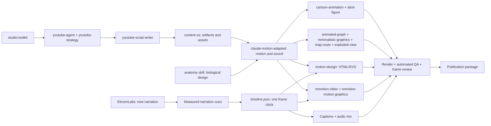

# Studio Toolkit

Fifteen native Codex skills and executable utilities for research-backed, narration-driven video production. This is a tested local production toolkit, not a promise that every generated video is ready for release. Human creative, audio, scientific and publishing approval remain separate from automated checks.

## Features

- YouTube ideas, channel strategy, 21 hook formulas, title/thumbnail linting, transcript cuts, chapters, retention exports and competitor outlier analysis.
- Source-first long-form scripts, creator voice, editorial calendars, asset ledgers and cross-platform repurposing.
- Deterministic HTML/SVG/JavaScript and React/Remotion production with local assets, procedural sound and frame-based narration cues.
- Structured artifact schemas, resumable hash checkpoints, caption consistency, media decoding, loudness measurement and contact sheets.
- Anatomy-skill routing for anatomical scenes, plus cached ElevenLabs production narration with provider-measured scene/word cues.
- Six adopted animation workflows: 3D cartoons, stick figures, minimalist line art, data graphs, illustrative map routes and exploded views.
- English and Arabic/RTL workflows; WAV, MP3 and M4A narration; landscape, vertical, square and optional 4K dimensions.

## Architecture



[Pipeline and schemas](docs/ARCHITECTURE.md) · [upstream audit](SOURCES.md) · [validation](docs/VALIDATION.md) · [Anatomy/ElevenLabs update](docs/WORKFLOW-UPDATE.md) · [demos](https://github.com/TahaGabroun/studio-toolkit-demos)

## Install

Python 3.10+ is sufficient for installation and the six YouTube tools. Full local media production also needs FFmpeg/ffprobe, Node 20+, Chromium and the project-local Python packages. Check your machine first:

```bash
git clone https://github.com/TahaGabroun/studio-toolkit.git
cd studio-toolkit
python3 -m venv .venv
.venv/bin/pip install -r requirements.txt
.venv/bin/python skills/studio-toolkit/scripts/studio.py doctor
bash install.sh install --global
bash install.sh validate --global
# Include the supplied Anatomy skill (fifteen skills + Anatomy):
bash install.sh install --global --with-anatomy
```

The installer respects `CODEX_HOME/skills`, otherwise prefers an existing `~/.agents/skills`, then an existing `~/.codex/skills`, and uses `~/.agents/skills` for a new installation. This machine uses the existing `~/.codex/skills` convention:

```bash
bash install.sh install --dest "${CODEX_HOME:-$HOME/.codex}/skills"
bash install.sh validate --dest "${CODEX_HOME:-$HOME/.codex}/skills"
```

Use one global target for your host to avoid duplicate discovery. A project-specific install uses `bash install.sh install --project /path/to/project`, creating its `.agents/skills`. The installer preflights every name, creates maintainable symlinks and refuses unrelated files. Skills become available on the next Codex turn; reload the app if its catalog has not refreshed. It does not grant shell/network/account access.

Commands: `install`, `validate`, `list`, `update`, `uninstall` all accept `--global`, `--project DIR` or `--dest DIR`. Add `--with-anatomy` to manage the supplied Anatomy integration as well, including on uninstall/update. `bash uninstall.sh --global` is a convenience wrapper. Uninstall removes only matching Studio-owned links. Move the checkout by uninstalling the old links first, moving it, then reinstalling. Windows users need Python and symlink privileges (or use WSL); only Linux installation/rendering was tested.

## Skills

| Skill | Responsibility |
|---|---|
| studio-toolkit | Routing, shared artifacts and production state |
| youtube-agent | Video planning/research/packaging and six executable export tools |
| youtube-strategy | Audits, positioning, SEO, thumbnails, competitors and optional API fetchers |
| youtube-script-writer | Long-form narration, hook/payoff, pacing and visual directions |
| content-os | Editorial planning, voice, corpus tools, assets and repurposing |
| claude-motion-adapted | Motion craft, composition, transitions and procedural sound |
| motion-design | Deterministic browser animation, capture and FFmpeg |
| remotion-video | Full React/Remotion editing, narration, compositing and renders |
| remotion-motion-graphics | Typography, diagrams, camera, terminal/editorial inserts and evidence |
| cartoon-animation | Procedural 3D people, props, shaders and authored explainer shots |
| stick-figure | Expressive Canvas character rigs, environments, transitions and sound code |
| minimalistic-graphics | Quiet dot/step/orbit line-art inserts |
| animated-graph | Supplied numeric series and synchronized counters |
| map-route | Seeded illustrative 3D city routes and destination cards |
| exploded-view | Six-layer phone insert or project-authored layered objects |

The `claude-motion-adapted` identifier preserves provenance; no Claude runtime is needed. [Archive aliases](skills/studio-toolkit/references/aliases.md) prevent ambiguous routing without installing duplicate skills.

## Use

Ask Codex: “Use $studio-toolkit to produce an Arabic scientific explainer from this narration, with precise diagram focus and reviewed captions.” Or invoke one specialist for a smaller task.

```bash
.venv/bin/python scripts/studio.py init my-film --title "A tree’s hidden building blocks" --duration 60
.venv/bin/python scripts/studio.py validate my-film
.venv/bin/python scripts/studio.py status my-film
.venv/bin/python scripts/studio.py align my-film --audio assets/narration.m4a --segments reviewed-segments.json --method manual-reviewed
.venv/bin/python scripts/studio.py complete my-film narration
```

`complete` requires prior stages and real validated outputs. An initialized workspace is a draft, not a finished film. `status` detects changed input/output hashes; refresh validated stages without regenerating approved writing. See [command reference](docs/COMMANDS.md), [narration and RTL](docs/NARRATION.md), and [production standards](skills/studio-toolkit/references/quality.md).

A runnable no-API HTML example is provided:

```bash
.venv/bin/python examples/run_example.py --output /tmp/studio-example
```

For four complete reproducible Remotion projects and real rendered examples, clone [Studio Toolkit Demos](https://github.com/TahaGabroun/studio-toolkit-demos) beside this checkout.

## Cartoon and template animation

Ask: `Use $studio-toolkit to create an original stick-figure explainer, using ElevenLabs and measured captions.` Or invoke `$cartoon-animation`, `$stick-figure`, `$animated-graph`, `$minimalistic-graphics`, `$map-route` or `$exploded-view` directly. The portable ChatGPT skill routes these same intents through its specialist references.

```bash
bash skills/studio-toolkit/references/animation-runtime/kit/setup.sh
.venv/bin/python scripts/animation.py doctor
.venv/bin/python scripts/animation.py build animated-graph examples/animation-specs/graph.json --snap 0.5,3.5
.venv/bin/python scripts/animation.py init stick-figure my-film/animation
.venv/bin/python examples/run_animation_smoke.py --output /tmp/studio-animation-check
```

Read [animation workflows](skills/studio-toolkit/references/animation-workflows.md) for JSON specs, character APIs, audio/timing import, rendering and recovery. These adopted templates are vertical/30 fps. The 3D cartoon source renders at 720×1280 and upscales to 1080×1920; maps are schematic, device layers generic. New default starters are silent calibrations. No automatic substitute voice or live-provider claim is made. [Animation validation](docs/ANIMATION-UPDATE.md) records executed checks.

## Production preferences

New projects receive production-config.json. Structured explanatory diagrams use the supplied Anatomy skill for visual design before HTML/Remotion implementation; newly generated production narration uses ElevenLabs. Read the [production workflow](skills/studio-toolkit/references/production-preferences.md) for skill discovery, voice setup, provider timings and reuse of cached responses. A missing skill/connection is reported explicitly. Existing supplied recordings and user overrides are preserved; the existing eSpeak/pulse examples remain calibration-only.

```bash
.venv/bin/python scripts/studio.py workflow-check my-film --anatomical --generate-narration
.venv/bin/python skills/studio-toolkit/scripts/elevenlabs_narration.py my-film --voice-id VOICE_ID --dry-run
.venv/bin/python skills/studio-toolkit/scripts/elevenlabs_narration.py my-film --voice-id VOICE_ID
```

Configure ELEVENLABS_API_KEY in the environment, never in the project. The voice ID is explicit; no cloned voice is created. Actual provider speech requires working account access and may use credits. The helper preserves approved project artifacts and requires review before generated candidates enter the shared timeline. The original nine skill IDs are retained alongside six animation specialists; the supplied Anatomy skill is bundled separately under integrations/anatomy and can also be installed globally with --with-anatomy.

## Dependencies and optional services

Core Python dependencies are pinned in requirements.txt; their resolved transitive versions are recorded in requirements-lock.txt. Use `pip install -r requirements-lock.txt` to reproduce the tested Python 3.10 Linux environment. Install the Playwright browser with `python -m playwright install chromium`, or supply `CHROMIUM=/path/to/compatible/chromium`. Ubuntu 26.04 was not recognized by pinned Playwright 1.56; the tested fallback download used `PLAYWRIGHT_HOST_PLATFORM_OVERRIDE=ubuntu24.04-x64` and was rendered successfully. A compatible system Chromium also works.

YouTube read-only APIs, yt-dlp captions, local Ollama insights and faster-whisper ASR are optional. [Optional integrations](docs/INTEGRATIONS.md) explains credentials, model downloads and unverified live services. No paid API is required for basic operation. ElevenLabs production narration has a real credential-gated helper; live generation requires your account. Image generation and YouTube upload are not bundled services; private analytics requires authorized account access. Remotion has its own [license terms](https://www.remotion.dev/docs/license), which are separate from the MIT toolkit.

## Test and distribute

```bash
.venv/bin/python scripts/validate_repository.py
.venv/bin/python -m unittest discover -s tests -v
.venv/bin/python scripts/package_chatgpt.py
```

`dist/studio-toolkit-chatgpt.skill` is a ZIP with exactly one SKILL.md, fourteen specialist references, scripts, schemas and license notices. It is designed for a ChatGPT host supporting skill import; actual import was not tested here. Ordinary ChatGPT does not acquire permanent skills from a Codex filesystem install. [Distribution details](docs/DISTRIBUTION.md).

## Troubleshooting and updates

- Missing module: activate the project venv and install requirements; never add packages globally merely to fix this toolkit.
- Browser missing: install Chromium or set CHROMIUM; report stderr if capture fails. Font and page errors fail rendering.
- Read-only global discovery directory: use the existing Codex home target or a project-scoped install. Do not overwrite another skill with a matching name.
- Narration or caption drift: replace stale timestamps and run align/validate. Do not stretch captions to fit a guessed script duration.
- Stale render: compare source, input, asset and lockfile hashes; rerender affected output. Hash validity does not prove visual approval.
- Existing checkout: commit/stash your own edits, `git pull --ff-only`, reinstall dependencies if locks changed, run tests, then `bash install.sh update` with the same target flags. Symlinked content updates immediately.

## Sources and license

Adapted from nine upstream projects plus the supplied Anatomy integration, with useful executable code retained and native workflows rewritten. [SOURCES.md](SOURCES.md) records exact upstream commits, scope, limitations and copied files. The initial eight MIT notices were checked on 2026-11-09; the animation upstream MIT/OFL notices were checked on 2026-11-10 and are preserved under third_party/licenses. Toolkit code is MIT. Third-party fonts, media, services and Remotion retain their own terms. No upstream example films, private recordings, product logos or credentials are bundled.
